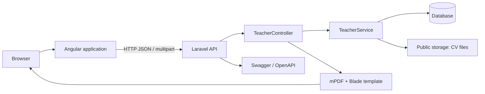

# ITech Teachers

ITech Teachers is a full-stack directory management application for maintaining teacher records, their multilingual profiles, and supporting CV documents. It provides a browser-based back-office interface backed by a Laravel REST API.


## Overview

The project centralizes teacher information that would otherwise be maintained across separate files. Users can create, browse, edit, search, export, and retire teacher records, while keeping profile content in French, English, and Arabic. CVs are stored by the API and can be downloaded from an individual teacher profile.

The repository contains two independently runnable applications:

- `front/`: an Angular single-page application (with SSR tooling configured)
- `backend/`: a Laravel 11 JSON API and PDF/CV document service

## Key features

- Create, view, update, and soft-delete teacher records.
- Maintain localized profile fields for French, English, and Arabic; the UI currently exposes French and English language switching.
- Validate CIN, email, phone number, birth date, and CV uploads in the UI and API.
- Upload PDF, DOC, or DOCX CVs (maximum 5 MB), then download the stored file.
- Generate a localized teacher profile PDF through the Laravel API.
- Filter the loaded teacher list in the browser by name, CIN, email, grade, department, and birth year.
- Export the current teacher list as CSV, XLSX, or PDF.
- Display localized interface text through `@ngx-translate` JSON catalogues and show toast notifications for user feedback.
- Publish OpenAPI annotations and an L5-Swagger UI for the API.

## Tech stack

| Area | Technologies |
| --- | --- |
| Frontend | Angular 19, TypeScript, RxJS, Angular Router, Reactive Forms |
| UI and i18n | Tailwind CSS, PrimeNG, `@ngx-translate/core` |
| Client-side exports | SheetJS (`xlsx`), jsPDF, jsPDF-AutoTable |
| Backend | PHP 8.2+, Laravel 11, Eloquent ORM |
| Documents | mPDF, Dompdf, Laravel public storage |
| API documentation | L5-Swagger / OpenAPI annotations |
| Database | Laravel database layer; SQLite is the default sample configuration, with MySQL, MariaDB, PostgreSQL, and SQL Server connections available in Laravel configuration |
| Testing and tooling | PHPUnit 10, Laravel Pint, Angular CLI, Karma/Jasmine, Vite |

## Architecture



The Angular application calls `/api/teachers` on the configured API base URL. `TeacherController` delegates persistence, translation handling, file storage, and soft deletion to `TeacherService`. A teacher has many translations, keyed by language code (`fr`, `en`, or `ar`). PDF generation renders a Blade profile template with mPDF.

## Data model

`teachers` stores the non-localized fields: `cin`, `email`, `phone_number`, `birth_date`, optional CV path, timestamps, and an `is_deleted` flag. CIN and email are unique in the initial migration. Deletion sets `is_deleted` to `true`; records are not physically removed.

`teacher_translations` belongs to a teacher and stores `first_name`, `last_name`, `address`, `grad`, and `department`. The `(teacher_id, language_code)` pair is unique, preventing duplicate translations for one language.

## Project structure

```text
.
├── front/                         # Angular application
│   ├── src/app/
│   │   ├── components/             # Header, sidebar, toast UI
│   │   ├── pages/                  # Teacher list, add, edit, detail, search
│   │   └── shared/                 # Toast service and container
│   ├── src/assets/i18n/            # English and French interface catalogues
│   ├── src/environments/           # API base-URL configuration
│   └── package.json                # Frontend scripts and dependencies
├── backend/                        # Laravel API
│   ├── app/Http/Controllers/       # Teacher endpoints and PDF/CV responses
│   ├── app/Http/Requests/          # Create/update request validation
│   ├── app/Models/                 # Teacher and TeacherTranslation models
│   ├── app/Services/               # Business logic and transactions
│   ├── app/Swagger/                # OpenAPI metadata and schemas
│   ├── database/migrations/        # Teacher, translation, and CV schema changes
│   ├── resources/views/pdf/        # Teacher PDF template
│   ├── routes/api.php              # API route declarations
│   └── composer.json               # Backend dependencies and scripts
└── README.md
```

## Getting started

### Prerequisites

- PHP 8.2 or later with the extensions required by Laravel and the selected database driver
- Composer
- Node.js and npm
- A supported database. The committed Laravel example configuration uses SQLite.

### 1. Start the API

From `backend/`:

```bash
composer install
```

The repository includes `backend/.env.example`. If you do not already have a local `.env`, create one from it, then set database values as needed:

```bash
cp .env.example .env
php artisan key:generate
php artisan migrate
php artisan storage:link
php artisan serve
```

On Windows PowerShell, use `Copy-Item .env.example .env` in place of `cp`. The local API configuration and frontend development URL expect the API at `http://localhost:8000`.

### 2. Start the frontend

In a second terminal, from `front/`:

```bash
npm install
npm start
```

Open `http://localhost:4200`. The development API URL is defined in `front/src/environments/environment.ts` as `http://localhost:8000/api`.

### 3. Configure a production API URL

Before a production frontend build, replace the placeholder `https://your-production-api.com/api` in `front/src/environments/environment.prod.ts` with the deployed API URL. The backend CORS configuration currently permits `http://localhost:4200`; adjust it for the production frontend origin.

## Environment configuration

The backend reads Laravel's standard environment file. Do not commit a populated `.env` file.

| Variable | Purpose | Required locally |
| --- | --- | --- |
| `APP_KEY` | Laravel encryption key, generated by `php artisan key:generate` | Yes |
| `APP_URL` | Public base URL of the Laravel application | Yes |
| `DB_CONNECTION` | Active database driver (`sqlite` in the example file) | Yes |
| `DB_DATABASE` | SQLite database path or database name, depending on the driver | Yes |
| `DB_HOST`, `DB_PORT`, `DB_USERNAME`, `DB_PASSWORD` | Connection parameters for server databases such as MySQL | Only for the selected server driver |
| `L5_SWAGGER_*` | Optional Swagger UI and document-generation settings | No |

The supplied example uses `DB_CONNECTION=sqlite` and resolves the database path through Laravel configuration. For MySQL, uncomment and complete the corresponding database fields in `.env`.

## API surface

The teacher API is declared in `backend/routes/api.php`.

| Method | Endpoint | Purpose |
| --- | --- | --- |
| `GET` | `/api/teachers?lang=fr` | List active teachers with localized fields |
| `POST` | `/api/teachers` | Create a teacher with multipart CV and translation payload |
| `GET` | `/api/teachers/{id}?lang=fr` | Retrieve one teacher |
| `PUT` | `/api/teachers/{id}` | Update a teacher; the frontend uses multipart POST with `_method=PUT` |
| `DELETE` | `/api/teachers/{id}` | Mark a teacher as deleted |
| `GET` | `/api/teachers/{id}/pdf/{lang}` | Download a generated profile PDF (`en`, `fr`, or `ar` route constraint) |
| `GET` | `/api/teachers/{id}/download-cv` | Download the stored CV |

Swagger UI is configured at `/api/documentation` when the Laravel application is running. The committed generated specification is located at `backend/storage/api-docs/api-docs.json`.

## Usage

1. Open the teacher list and choose **Add teacher**.
2. Supply the required identity and contact fields, French and English profile content, and a PDF/DOC/DOCX CV.
3. Open a profile to download its CV or generate a profile PDF.
4. Use the list filters to narrow currently loaded results, or export the visible list as CSV, XLSX, or PDF.

## Testing and quality checks

Frontend unit-test specifications use Jasmine/Karma; Laravel includes PHPUnit unit and feature test suites. Run them from their respective applications:

```bash
# front/
npm test
npm run build

# backend/
php artisan test
```

`npm test` requires a Chrome-compatible Karma launcher environment. The repository currently contains the framework example tests; it does not provide end-to-end test configuration.


